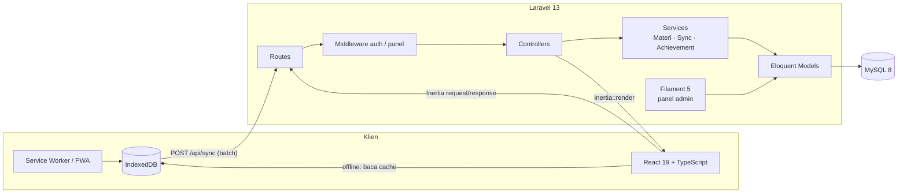
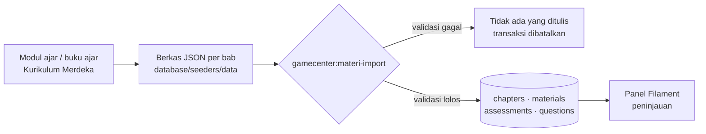

# Game Center Edukasi

Sistem belajar berbasis permainan (game-based learning) untuk jenjang **PAUD,
TK, SD-MI, SMP-MTs, dan SMA-SMK**. Siswa membaca materi kurikulum, mengerjakan
soal dalam tiga tingkat kesulitan, lalu mendapat skor, XP, koin, dan lencana.
Guru dan admin mengelola jenjang, kelas, mapel, bab, materi, soal, serta
keanggotaan lewat panel admin.

Seluruh materi berasal dari buku ajar dan modul ajar **Kurikulum Merdeka**
(Kemdikdasmen), dikurasi menjadi berkas JSON yang diimpor secara idempoten.

| | |
|---|---|
| Repo | <https://github.com/admin-smksgrl/gamecenter> |
| Versi rilis | **0.43.0** ([changelog](gamecenter/changelog.md)) |
| Bahasa antarmuka | Indonesia |
| Lisensi kode | MIT |

---

## 1. Sistem ini untuk apa

Sekolah dan guru sering punya tiga masalah saat ingin memakai game edukasi:

1. **Materi tidak sesuai kurikulum** — game komersial tidak mengikuti capaian
   pembelajaran (CP) dan tujuan pembelajaran (TP) resmi.
2. **Tidak ada rekap** — nilai permainan tidak masuk ke mana pun, jadi tidak
   bisa dipakai untuk menilai atau memantau kemajuan.
3. **Jaringan sekolah lemah** — aplikasi berbasis video/streaming tidak jalan.

Game Center Edukasi menjawab ketiganya:

- Setiap bab diturunkan dari **satu modul ajar**; tujuan pembelajarannya dikutip
  apa adanya dari modul (`I. TUJUAN PEMBELAJARAN`), bukan ditulis ulang.
- Semua hasil permainan tersimpan: skor, jawaban per soal, XP, koin, lencana,
  riwayat sesi, dan progres per bab — dapat ditinjau siswa dan guru.
- **Offline-first**: katalog, materi, dan soal disimpan di IndexedDB lewat
  service worker, sehingga tetap bisa dibuka saat internet putus; hasil
  dikirim ulang otomatis ketika jaringan kembali.

## 2. Siapa penggunanya

| Peran | Masuk | Yang bisa dilakukan |
|-------|-------|---------------------|
| **Siswa** | `/masuk` | Menjelajah materi per jenjang/kelas/mapel, bermain (solo atau kelompok), melihat progres, riwayat, lencana, dan pembahasan jawaban, mengajukan upgrade keanggotaan |
| **Guru** | `/masuk` → `/admin` | Meninjau bab & materi hasil impor, melihat keanggotaan |
| **Admin** | `/masuk` → `/admin` | Semua di atas + menyetujui pengajuan keanggotaan, mengelola paket, rombel, mapel, dan konten |

Satu halaman masuk untuk semua peran; tujuan setelah autentikasi ditentukan
oleh peran akun, bukan oleh URL yang berbeda.

## 3. Fitur

**Belajar & bermain**
- Katalog materi: filter jenjang → kelas → mapel → mode, pencarian (`/`), pagination.
- Navigasi jenjang **PAUD, TK, SD-MI, SMP-MTs, SMA-SMK**; SMA dan SMK digabung
  dalam satu pilihan karena yang berbeda hanya sebagian mapel kejuruan.
- Halaman bermain: materi (porsi ±60%) → intro → soal bertimer → umpan balik →
  hasil.
- Enam tipe soal: pilihan ganda, pilihan ganda kompleks, urutan (drag-drop),
  menjodohkan, simulasi, dan uraian.
- Tiga tingkat kesulitan: **mudah** 5 soal/10 poin/90 detik, **sedang**
  10 soal/20 poin/75 detik, **sulit** 15 soal/30 poin/60 detik (tanpa hint).
- Mode solo (nama pemain) dan kelompok (nama kelompok + hingga 8 pemain).

**Gamifikasi & laporan**
- Skor, XP, koin, level pengguna, dan lencana.
- `/progres`: statistik, aktivitas, riwayat sesi, koleksi lencana.
- `/hasil/{sesi}`: ringkasan nilai dan pembahasan tiap jawaban.

**Keanggotaan**
- Katalog paket (gratis/profesional), pengajuan upgrade, riwayat pengajuan.
- Persetujuan pengajuan oleh admin di panel Filament.

**Operasional**
- Panel admin Filament: dashboard statistik, peninjauan bab hasil impor.
- PWA + service worker: aset & katalog di-cache, halaman tetap terbuka offline.
- API sinkronisasi batch `POST /api/sync` yang idempoten dan menghitung skor di
  server (klien tidak bisa mengarang skor).
- Perintah pemeliharaan: `gamecenter:materi-import`, `gamecenter:deploy-check`.

## 4. Arsitektur

Aplikasi **monolit Laravel dengan Inertia** — tidak ada API terpisah untuk
halaman web. Server mengirim data sebagai *props* Inertia, React merender di
peramban. API hanya dipakai untuk sinkronisasi offline (`/api/*`).



### Lapisan

| Lapisan | Isi | Lokasi |
|---------|-----|--------|
| Routing | Web (Inertia), API (Sanctum), panel Filament | `routes/web.php`, `routes/api.php`, `app/Providers/Filament` |
| HTTP | Controller per halaman: katalog, bermain, progres, hasil, panduan, keanggotaan, auth | `app/Http/Controllers` |
| Domain/service | Import materi (validasi + transaksi), sinkronisasi offline, pemberian lencana | `app/Services` |
| Data | 17 model Eloquent + 8 enum (`Difficulty`, `QuestionType`, `MaterialType`, `UserRole`, …) | `app/Models`, `app/Enums` |
| Tampilan | Halaman Inertia + komponen game + layout bertema | `resources/js/Pages`, `resources/js/Components` |
| Aset | Tailwind v4 (token CSS), font self-hosted, build Vite | `resources/css`, `resources/js` |

### Alur satu permainan

1. `GET /` → `GameCenterController@index` memuat jenjang → kelas → mapel → bab →
   asesmen beserta jumlah soal, lalu mengirim props ke `GameCenter/Index`.
2. Siswa memilih mode → `GET /main/{assessment}` → `PlayController@show`
   mengirim materi + soal (tanpa kunci jawaban untuk soal yang belum dijawab).
3. Jawaban dikirim bertahap; server menyimpan `SessionAnswer`, menghitung skor
   dan waktu.
4. Selesai → `GameSession` ditutup, `SessionResult` dibuat, XP/koin/lencana
   diberikan lewat `AchievementService`.
5. `GET /hasil/{gameSession}` menampilkan ringkasan dan pembahasan.

### Model data

```
education_levels ──< classes ──< subjects ──< chapters ──< learning_materials
                                                   └──< assessments ──< questions ──< question_options

users ──< game_sessions ──< session_answers
      │                └──< session_results
      ├──< user_progress        (progres bab + materi yang sudah dibaca)
      ├──< achievements
      ├──< memberships >── membership_plans
      └──< sync_queue           (antrean kirim hasil saat offline)
```

### Pipeline materi

JSON adalah **sumber kebenaran**; panel admin hanya untuk meninjau.



Aturan berkas materi:

- Satu modul ajar = satu bab = satu berkas `fase-e/<mapel>/<kode>-<slug>.json`.
- Setiap bab: **3 materi** + **3 asesmen**; soal **5 mudah / 10 sedang / 15 sulit**.
- Setiap soal wajib punya `explanation`; `hint` **dilarang** pada soal sulit.
- Simbol matematika memakai Unicode (`²`, `×`, `÷`, `√`), bukan LaTeX.
- Importer **idempoten dan transaksional**: satu masalah validasi berarti tidak
  ada satu baris pun yang ditulis.

## 5. Stack

| Bagian | Teknologi | Versi |
|--------|-----------|-------|
| Bahasa server | PHP | ^8.3 |
| Framework | Laravel | 13 |
| Panel admin | Filament | 5 |
| Jembatan server–klien | Inertia.js (`inertiajs/inertia-laravel`, `@inertiajs/react`) | 3.7 / 3.11 |
| UI | React + TypeScript | 19.3 / 7 |
| Gaya | Tailwind CSS (+ token CSS kustom) | 4 |
| Build | Vite | 7 |
| Basis data | MySQL 8 / MariaDB 10.6+ | — |
| API token | Laravel Sanctum | 4.4 |
| Diagram panduan | Mermaid | 12 |
| Font | Fraunces Variable, Instrument Sans Variable (self-hosted) | 5 |
| PWA | Service worker manual (`public/sw.js`) + IndexedDB | — |
| Tes | PHPUnit | 12 |

## 6. Struktur repo

```
gamecenter/                 aplikasi Laravel
├── app/
│   ├── Console/Commands/   materi-import, deploy-check
│   ├── Enums/              8 enum domain
│   ├── Filament/           panel admin (Chapters, Memberships, MembershipPlans)
│   ├── Http/Controllers/   halaman web + API sync
│   ├── Models/             17 model Eloquent
│   └── Services/           Materi (importer), Sync, Achievement
├── database/
│   ├── migrations/         21 migrasi
│   └── seeders/            jenjang, kelas, mapel, materi kurasi
│       └── data/sma-smk/   94 berkas JSON bab (2.820 soal)
├── resources/
│   ├── css/                token tema (merah #e60012 + putih)
│   ├── js/Pages/           Inertia pages (GameCenter, Guide, Membership, Auth)
│   └── js/Components/      mesin game, toast, layout
├── routes/                 web.php, api.php
├── tests/                  154 tes (Feature + Unit)
└── public/sw.js            service worker PWA

doc/                        rencana, laporan per fase, peta cakupan materi
artisan, serve.bat          pintasan menjalankan dari folder induk
```

> Folder `data/` (sumber kurikulum mentah ±1,5 GB: buku ajar, ATP, CP, prosem)
> **tidak** disertakan di repo. Materi yang sudah dikurasi ada di
> `gamecenter/database/seeders/data/`.

## 7. Isi basis data saat ini

| Entitas | Jumlah |
|---------|--------|
| Jenjang | 6 (PAUD, TK, SD-MI, SMP-MTs, SMA, SMK) |
| Rombel | 18 |
| Mata pelajaran | 182 |
| Bab | 98 (93 kurasi SMA/SMK + 5 contoh) |
| Materi | 292 |
| Soal | 2.880 (mudah/sedang/sulit, 5 tipe soal interaktif) |
| Asesmen | 294 |

Jenjang **SD-MI** sudah punya rombel dan mapel tetapi belum punya bab; halaman
menampilkan pemberitahuan bahwa materinya sedang disiapkan.

## 8. Pasang & jalankan

Kebutuhan: PHP 8.3+, Composer 2, Node.js 20+, MySQL 8 / MariaDB 10.6+.

```bash
cd gamecenter

composer install
npm install

cp .env.example .env          # Windows: copy .env.example .env
php artisan key:generate
# isi DB_DATABASE / DB_USERNAME / DB_PASSWORD di .env

php artisan migrate --seed
npm run build
php artisan serve             # http://127.0.0.1:8000
```

Akun demo (kata sandi semuanya `password`, masuk dengan **username**):

| Username | Peran | Jenjang |
|----------|-------|---------|
| `admin` | admin | — |
| `guru` | guru | — |
| `siswa` | siswa | SMA, Kelas 10 |
| `siswa-smk` | siswa | SMK, Kelas 10 |

Untuk pengembangan: `npm run dev` (Vite HMR) di samping `php artisan serve`.

## 9. Perintah

```bash
# Materi & soal
php artisan gamecenter:materi-import                 # impor semua JSON
php artisan gamecenter:materi-import --dry-run       # uji tanpa menulis
php artisan gamecenter:materi-import path/berkas.json

# Kesiapan rilis (18 pemeriksaan)
php artisan gamecenter:deploy-check                  # laporan
php artisan gamecenter:deploy-check --strict         # gagal bila ada peringatan (CI)

# Pengembangan
php artisan test                                     # seluruh tes
npm run typecheck                                    # tsc --noEmit
npm run build                                        # aset produksi
```

Jalankan `php artisan optimize:clear` sebelum `php artisan test` bila konfigurasi
pernah di-cache.

## 10. Tema

Satu warna untuk semua jenjang: **merah `#e60012` di atas putih**.

- Semua aksen, bayangan, dan sorotan diturunkan dari satu token
  (`--level-accent` / `--color-red*`) di `resources/css/app.css`, sehingga tidak
  mungkin ada warna jenjang lain yang bocor.
- Panel admin memakai merah yang sama.
- Jenjang dibedakan lewat **isi dan label**, bukan warna.
- Mode gelap tersedia (toggle di topbar, pilihan disimpan).

## 11. Kualitas & pengujian

- **154 tes / 1.911 asersi** mencakup katalog, permainan, hasil, progres, auth,
  keanggotaan, impor materi, panel admin, dan perintah deploy-check.
- **Importer** menolak berkas yang melanggar skema (jumlah materi/asesmen, soal
  per tingkat kesulitan, `explanation` kosong, `hint` pada soal sulit, simbol
  LaTeX, karakter rusak `U+FFFD`) dan membatalkan seluruh transaksi.
- **`deploy-check`** memeriksa 18 hal: `.env`, `APP_KEY`, `APP_DEBUG`, aset build,
  migrasi, jumlah konten, kunci jawaban ganda, port, dan lain-lain.
- Verifikasi tampilan dilakukan di peramban sungguhan (Playwright), bukan hanya
  tes unit.

## 12. Deploy

1. `composer install --no-dev --optimize-autoloader`
2. `npm ci && npm run build`
3. Salin `.env.production.example` → `.env`, isi nilai `>>> GANTI <<<`.
4. `php artisan migrate --force` lalu `php artisan gamecenter:materi-import`.
5. `php artisan optimize` (config, route, view cache).
6. Dokumen akar web diarahkan ke `gamecenter/public`.
7. Jalankan `php artisan gamecenter:deploy-check --strict` sebagai gerbang rilis.

Rincian: [doc/fase-5-implementasi.md](doc/fase-5-implementasi.md).

## 13. Dokumentasi

| Dokumen | Isi |
|---------|-----|
| [doc/plan-materi-SMASMK.md](doc/plan-materi-SMASMK.md) | Rencana materi SMA/SMK: 79 bab, 2.370 soal, 5 tahap |
| [doc/peta-cakupan-materi.md](doc/peta-cakupan-materi.md) | Peta cakupan 88 buku ajar / ±253 bab + urutan pengerjaan |
| [doc/fase-4-implementasi.md](doc/fase-4-implementasi.md) | Tema, navigasi jenjang, dan keputusan desain |
| [doc/fase-5-implementasi.md](doc/fase-5-implementasi.md) | Kesiapan deploy & gerbang rilis |
| [gamecenter/changelog.md](gamecenter/changelog.md) | Riwayat rilis 0.1.0 → 0.43.0 |
| [gamecenter/README.md](gamecenter/README.md) | Catatan teknis aplikasi (skema, halaman, API) |

## 14. Peta jalan

**Sudah**
- Fondasi aplikasi, 17 tabel domain, auth satu pintu, panel admin.
- Mesin permainan 6 tipe soal, gamifikasi, progres, hasil, pembahasan.
- Offline-first (IndexedDB + antrean sinkronisasi + PWA).
- Keanggotaan, pusat bantuan, dashboard admin.
- Materi SMA/SMK: 94 bab kurasi (Matematika, Informatika, Bahasa Indonesia, IPA,
  Pancasila, PAI, Bahasa Inggris, IPS, PJOK, Prakarya, Projek IPAS, Kepercayaan)
  = 2.820 soal.
- **Buku Kelas X tuntas: 14/14 unit Prakarya, 8/8 bab PJOK, 6/6 bab Projek IPAS
  (SMK), dan 8/8 bab Pendidikan Kepercayaan.**
- Navigasi jenjang Indonesia + satu tema merah/putih.

**Berikutnya**
1. Kelas X: Sejarah dan buku kejuruan SMK (Agriteknologi, Animasi, DKV,
   Otomotif, TJKT, Mesin, Elektronika, Konstruksi).
2. Kelas XI (17 buku) dan XII (18 buku).
4. Isi materi SD-MI (struktur rombel dan mapel sudah siap).
5. Peninjauan guru atas kunci jawaban dan kalibrasi kesulitan.
6. Soal tipe `simulation` untuk setiap bab (belum ada).

## 15. Lisensi

Kode aplikasi: **MIT**. Materi pembelajaran dikurasi dari buku ajar dan modul
ajar Kurikulum Merdeka; hak cipta materi tetap pada pemiliknya masing-masing.
