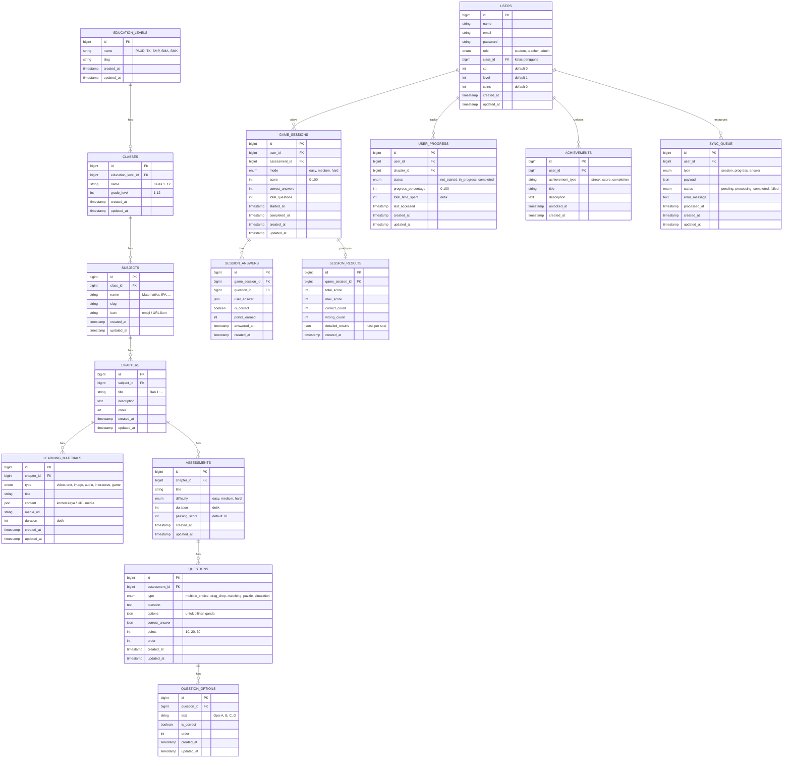

# Game Center Edukasi — Rencana Implementasi

> **Status:** Fase 1–4 selesai — fondasi, offline-first, game engine, tema per jenjang, dan halaman progres berjalan. Fase 5 sebagian selesai (kesiapan deploy); setup server & UAT menunggu.  
> **Target platform:** Web (PWA), Android, Linux desktop (via wrapper web).  
> **Sumber materi:** SIBI — Sistem Informasi Perbukuan Indonesia (buku.kemendikdasmen.go.id).  
> **Komposisi gameplay:** 60% materi, 40% tes.  
> **Prinsip utama:** Offline-first, sinkronisasi saat online, server ringan, mudah dikembangkan & dideploy.

---

## 1. Ringkasan Eksekutif

Game Center Edukasi adalah aplikasi game edukasi berbasis web (PWA) untuk jenjang PAUD, TK, SMP, SMA/SMK dengan filter jenjang pendidikan, kelas, mata pelajaran, dan mode kesulitan (easy/medium/hard). Materi bersumber dari buku resmi Kemdikdasmen (SIBI).

**Prinsip arsitektur:**

| Prinsip | Implementasi |
|---------|-------------|
| Offline-first | IndexedDB menyimpan materi, soal, progres, dan antrian sinkronisasi di perangkat siswa |
| Sinkronisasi otomatis | Service Worker + Background Sync API mengirim data ke server saat online |
| Server ringan | Komputasi game (skor, jawaban) di client; server hanya validasi & persist |
| Akun portable | Login di device lain → progres tersimpan di server, bisa dilanjutkan |
| Mudah dikembangkan | Modular: resource/content terpisah dari game engine; plugin-based |
| Mudah dideploy | PHP + shared hosting (cPanel), tanpa VPS |

**Tech stack final:**

```
Backend:     Laravel 13 + Filament 5 (admin panel) + Inertia.js (game client)
Frontend:    Inertia.js + React 19 + TypeScript + Tailwind CSS + Vite
Database:    MySQL 8 / MariaDB 10.6+
Offline:     PWA (Service Worker + IndexedDB + Background Sync)
Auth:        Laravel Sanctum (SPA session + mobile token)
Deploy:      Shared hosting (cPanel) — PHP 8.3+, Node.js 20+ untuk build lokal
```

---

## 2. Arsitektur Sistem

### 2.1 Diagram Komponen

```
┌─────────────────────────────────────────────────────────────────┐
│                        CLIENT (PWA / React)                      │
├─────────────────────────────────────────────────────────────────┤
│  Game UI (Inertia.js + React)                                    │
│    ├── Filter: jenjang → kelas → mapel → mode                    │
│    ├── Game Engine (Quiz, Drag & Drop, Matching, Puzzle, Simulasi)│
│    ├── Reward & Progress (XP, badge, streak)                     │
│    └── Offline Storage (IndexedDB)                               │
│         ├── materials / questions / assessments (cache)          │
│         ├── progress (offline)                                   │
│         └── syncQueue (pending sync)                             │
│                                                                  │
│  Service Worker:                                                 │
│    ├── Cache API (app shell, aset statis)                        │
│    └── Background Sync (sync antrian saat online)                │
└──────────────────────────┬──────────────────────────────────────┘
                           │ HTTPS (saat online)
┌──────────────────────────▼──────────────────────────────────────┐
│                     SERVER (Laravel 13)                          │
├─────────────────────────────────────────────────────────────────┤
│  Inertia.js (SSR/SPA)  ──  Filament 5 (Admin Panel)              │
│                                                                  │
│  API Routes (Sanctum):                                           │
│    ├── GET  /api/catalog          → daftar materi & metadata      │
│    ├── POST /api/sync             → terima batch antrian         │
│    ├── POST /api/sessions         → buat sesi game               │
│    └── POST /api/sync/answer      → submit jawaban (validasi)    │
│                                                                  │
│  Database (MySQL):                                               │
│    ├── Catalog: education_levels, classes, subjects, chapters,   │
│    │            learning_materials, assessments, questions        │
│    ├── Users & Sessions: users, game_sessions, session_answers,  │
│    │                     session_results                          │
│    └── Sync & Progress: sync_queue, user_progress, achievements  │
└─────────────────────────────────────────────────────────────────┘
```

### 2.2 Alur Offline-First

```
1. Siswa membuka game (pernah online sebelumnya, aset ter-cache)
2. Game memuat materi & soal dari IndexedDB → main tanpa internet
3. Setiap jawaban & progres disimpan ke IndexedDB + antrian sync
4. Saat internet tersedia (online event / background sync):
   a. Service Worker mengambil antrian dari IndexedDB
   b. POST /api/sync (batch, satu request untuk banyak item)
   c. Server memvalidasi, menyimpan ke DB, mengembalikan status
   d. Antrian yang berhasil dihapus dari IndexedDB
5. Jika login di device lain → server mengembalikan progres terbaru
```

---

## 3. Diagram Entity Relationship (ER)

### 3.1 ERD (Mermaid)



### 3.2 Relasi Penting

| Relasi | Jenis | Keterangan |
|--------|-------|------------|
| EDUCATION_LEVELS → CLASSES | One-to-Many | PAUD/TK/SMP/SMA/SMK memiliki banyak kelas |
| CLASSES → SUBJECTS | One-to-Many | Satu kelas memiliki banyak mapel |
| SUBJECTS → CHAPTERS | One-to-Many | Satu mapel memiliki banyak bab |
| CHAPTERS → LEARNING_MATERIALS | One-to-Many | Satu bab memiliki banyak materi (60%) |
| CHAPTERS → ASSESSMENTS | One-to-Many | Satu bab memiliki banyak tes (40%) |
| ASSESSMENTS → QUESTIONS | One-to-Many | Satu tes memiliki banyak soal |
| QUESTIONS → QUESTION_OPTIONS | One-to-Many | Soal pilihan ganda memiliki opsi |
| USERS → GAME_SESSIONS | One-to-Many | Siswa memiliki banyak sesi bermain |
| GAME_SESSIONS → SESSION_ANSWERS | One-to-Many | Satu sesi memiliki banyak jawaban |
| GAME_SESSIONS → SESSION_RESULTS | One-to-One | Satu sesi menghasilkan satu ringkasan |
| USERS → USER_PROGRESS | One-to-Many | Progres per bab per siswa |
| USERS → ACHIEVEMENTS | One-to-Many | Pencapaian yang dibuka siswa |
| USERS → SYNC_QUEUE | One-to-Many | Antrian data offline yang menunggu kirim |

---

## 4. Desain Game per Jenjang Pendidikan

### 4.1 Tema & Visual

| Jenjang | Usia | Tema | Warna | Font | Interaksi utama |
|---------|------|------|-------|------|-----------------|
| **PAUD** | 3–5 | Kartun, hewan, bentuk | Primer cerah (merah/kuning/biru/hijau) | Comic Sans, Arial Rounded | Tap, drag & drop sederhana, suara |
| **TK** | 5–7 | Petualangan, alam | Pastel cerah, gradasi lembut | Nunito, Quicksand | Drag & drop, swipe, memory card |
| **SMP** | 12–15 | Sci-fi, ruang angkasa | Biru/ungu/hijau neon, aksen oranye | Roboto, Open Sans | Quiz timer, puzzle, lab virtual |
| **SMA/SMK** | 15–18 | Realistis, profesional | Biru tua, abu-abu, aksen emas/merah | Inter, SF Pro | Simulasi, studi kasus, keyboard shortcut |

### 4.2 Mekanisme Game per Jenjang

**PAUD / TK — visual & audio, minim teks:**

```
Drag & Drop Bentuk:          Tap & Learn (Audio):
┌─────────────────────┐      ┌─────────────────────┐
│  ⭕  →  [  ⭕  ]     │      │  🔊 "Moo"           │
│  ⬜  →  [  ⬜  ]     │      │  [🐄] [🐖] [🐑]     │
│  🔺  →  [  🔺  ]     │      │  Pilih hewan benar  │
└─────────────────────┘      └─────────────────────┘
```

**SMP — quiz & puzzle dengan timer:**

```
Quiz Timer:                   Puzzle Matematika:
┌─────────────────────┐      ┌─────────────────────┐
│ ⏱ 00:45  💯 70  🔥3 │      │ 3 × [ ? ] = 24      │
│ 15 + 27 = ?         │      │ Drag: [6] [8] [12]  │
│ [32] [42] [52] [62] │      └─────────────────────┘
└─────────────────────┘
```

**SMA/SMK — simulasi & studi kasus:**

```
Simulasi Bisnis:
┌─────────────────────────────────┐
│ Stok 50 │ Modal Rp 1.000.000    │
│ Permintaan naik 30%, supplier    │
│ tutup 2 hari. Tindakan?          │
│ A. Beli stok besar              │
│ B. Sewa gudang tambahan          │
│ C. Kurangi harga                 │
│ D. Tunggu & lihat                │
└─────────────────────────────────┘
```

### 4.3 Mode Kesulitan

| Parameter | Easy | Medium | Hard |
|-----------|------|--------|------|
| Jumlah soal | 5 | 10 | 15 |
| Waktu per soal | 60–90s | 45–75s | 30–60s |
| Hint | Tersedia penuh | Terbatas | Tidak ada |
| Poin per soal benar | 10 | 20 | 30 |
| Bonus streak | 2× | 3× | 5× |

### 4.4 Sistem Reward & Progression

| Jenjang | XP per jawaban benar | XP selesai level | Lencana contoh |
|---------|----------------------|------------------|----------------|
| PAUD | 5 | 20 | `puzzle-master` |
| TK | 10 | 30 | `counting-star` |
| SMP | 15 | 50 (perfect) | `math-genius` |
| SMA/SMK | 20 | 100 (perfect) | `case-master` |

**Level:** 1 Pemula (0 XP) → 2 Pemain (100) → 3 Ahli (250) → 4 Master (500) → 5 Legenda (1000).

---

## 5. Struktur Database (Ringkasan Migrasi)

| Tabel | Kolom Kunci | Catatan |
|-------|-------------|---------|
| `education_levels` | id, name, slug | PAUD/TK/SMP/SMA/SMK |
| `classes` | id, education_level_id, name, grade_level | Kelas 1–12 |
| `subjects` | id, class_id, name, slug, icon | Mapel per kelas |
| `chapters` | id, subject_id, title, description, order | Bab per mapel |
| `learning_materials` | id, chapter_id, type, title, content (json), media_url, duration | Materi 60% |
| `assessments` | id, chapter_id, title, difficulty, duration, passing_score | Tes 40% |
| `questions` | id, assessment_id, type, question, options (json), correct_answer (json), points, order | Bank soal |
| `question_options` | id, question_id, text, is_correct, order | Opsi pilihan ganda |
| `users` | id, name, email, password, role, class_id, xp, level, coins | Siswa/guru/admin |
| `game_sessions` | id, user_id, assessment_id, mode, score, correct_answers, total_questions, started_at, completed_at | Sesi bermain |
| `session_answers` | id, game_session_id, question_id, user_answer (json), is_correct, points_earned, answered_at | Jawaban per soal |
| `session_results` | id, game_session_id, total_score, max_score, correct_count, wrong_count, detailed_results (json) | Hasil akhir sesi |
| `user_progress` | id, user_id, chapter_id, status, progress_percentage, total_time_spent, last_accessed | Progres per bab (unique: user_id+chapter_id) |
| `achievements` | id, user_id, achievement_type, title, description, unlocked_at | Lencana |
| `sync_queue` | id, user_id, type, payload (json), status, error_message, processed_at | Antrian sinkronisasi (index: user_id+status) |

---

## 6. Arsitektur Offline-First

### 6.1 IndexedDB Schema (Client)

| Object Store | Key Path | Index |
|--------------|----------|-------|
| `materials` | id | chapter_id, type |
| `questions` | id | assessment_id, type |
| `assessments` | id | chapter_id, difficulty |
| `progress` | id | user_id, chapter_id |
| `sessions` | id (autoIncrement) | user_id, status |
| `syncQueue` | id (autoIncrement) | type, status |
| `userSettings` | key | — |

### 6.2 Alur Sinkronisasi

1. **Offline:** Semua aksi (jawaban, progres, selesai sesi) disimpan ke IndexedDB + antrian `syncQueue` (status `pending`).
2. **Online event / Background Sync:** Service Worker mengambil antrian, mengirim batch ke `POST /api/sync`, menghapus item yang berhasil.
3. **Retry:** Item gagal tetap di antrian; dicoba lagi berikutnya.
4. **Progres portable:** Saat login di device baru, server mengembalikan `user_progress` + `game_sessions` terbaru.

### 6.3 Service Worker

- **Cache API:** App shell, aset statis (CSS/JS), halaman offline.
- **Background Sync API:** Tag `gamecenter-sync`, listener `sync` event → kirim antrian.
- **Fallback:** Jika offline dan aset tidak ada di cache → halaman offline.

---

## 7. Filament 5 (Admin Panel)

### 7.1 Peran Filament

Filament 5 adalah **admin panel** untuk manajemen data & operasional:

- **Resource:** CRUD `education_levels`, `classes`, `subjects`, `chapters`, `learning_materials`, `assessments`, `questions`, `users`, `achievements`.
- **Widgets:** Dashboard statistik (jumlah siswa, sesi aktif, skor rata-rata, antrian sync).
- **Notifikasi:** Database notification & flash message.

### 7.2 Struktur

```
app/Filament/
├── Resources/
│   ├── EducationLevelResource.php
│   ├── ClassResource.php
│   ├── SubjectResource.php
│   ├── ChapterResource.php
│   ├── LearningMaterialResource.php
│   ├── AssessmentResource.php
│   ├── QuestionResource.php
│   └── UserResource.php
├── Pages/
│   └── Dashboard.php
└── Widgets/
    ├── StatsOverviewWidget.php
    └── SyncQueueWidget.php
```

### 7.3 Catatan

- Filament **tidak digunakan** untuk game siswa (tetap Inertia.js + React).
- Filament berjalan di panel terpisah (mis. `/admin`).
- Ekstensi: `php artisan make:filament-resource` + `--generate` untuk form/table otomatis.

---

## 8. Deployment (Shared Hosting)

### 8.1 Persyaratan Server

- PHP 8.3+ dengan ekstensi: Ctype, cURL, DOM, Fileinfo, Filter, Hash, Mbstring, OpenSSL, PCRE, PDO, Session, Tokenizer, XML.
- MySQL 8 / MariaDB 10.6+.
- Node.js 20+ (hanya untuk build aset di lokal, tidak wajib di server).
- Composer (untuk install dependency; bisa dilakukan di lokal).

### 8.2 Penyedia Shared Hosting (ID)

| Penyedia | PHP 8.3 | Composer | Node.js | Catatan |
|----------|---------|----------|---------|---------|
| Niagahoster | ✅ | ✅ | ✅ | Ada paket Laravel Hosting |
| Hostinger | ✅ | ✅ | ✅ | Shared hosting dengan dukungan Laravel |
| Rumahweb | ✅ | ✅ | ✅ | Paket khusus Laravel |
| IDCloudHost | ✅ | ✅ | ✅ | PHP 8.3, cocok Laravel |
| Dewaweb | ✅ | ✅ | ✅ | Mudah deploy Laravel |

### 8.3 Langkah Deploy (cPanel)

1. **Build lokal (Laragon):**
   ```bash
   npm install
   npm run build
   php artisan optimize
   ```
2. **Upload via FTP/File Manager:**
   - `public_html` ← isi folder `public`
   - Root domain ← `app`, `bootstrap`, `config`, `database`, `resources`, `routes`, `storage`, `vendor`
   - Sesuaikan `public_html/index.php` agar mengarah ke `__DIR__.'/../index.php'` Laravel.
3. **Konfigurasi `.env`** di server (DB, APP_URL, APP_DEBUG=false).
4. **Migrasi:** via phpMyAdmin (import SQL) atau SSH (`php artisan migrate --force`).
5. **Cache:** `php artisan config:cache`, `route:cache`, `view:cache` (atau `optimize`).
6. **Storage symlink:** `php artisan storage:link` (jika ada upload media).

### 8.4 Environment (Laragon — Dev)

```env
APP_NAME=GameCenter
APP_ENV=local
APP_KEY=
APP_DEBUG=true
APP_URL=http://gamecenter.test

DB_CONNECTION=mysql
DB_HOST=127.0.0.1
DB_PORT=3306
DB_DATABASE=gamecenter
DB_USERNAME=root
DB_PASSWORD=

CACHE_DRIVER=file
QUEUE_CONNECTION=sync
SESSION_DRIVER=file
SESSION_LIFETIME=120

VITE_APP_NAME="${APP_NAME}"
```

---

## 9. Struktur Direktori Proyek

```
gamecenter/
├── app/
│   ├── Filament/              # Admin Panel (Filament 5)
│   │   ├── Resources/
│   │   ├── Pages/
│   │   └── Widgets/
│   ├── Http/
│   │   ├── Controllers/
│   │   │   ├── GameCenterController.php   # Inertia (siswa)
│   │   │   ├── GamePlayController.php
│   │   │   ├── GameResultController.php
│   │   │   ├── ProgressController.php
│   │   │   └── SyncController.php         # API sinkronisasi
│   │   ├── Middleware/HandleInertiaRequests.php
│   │   └── Requests/
│   ├── Models/                # 14+ model Eloquent
│   └── Services/
│       ├── GameSessionService.php
│       ├── ProgressService.php
│       └── AchievementService.php
├── database/
│   ├── migrations/            # 14 migrasi utama
│   ├── seeders/               # EducationLevel, Class, Subject, SampleData
│   └── factories/
├── resources/
│   ├── js/
│   │   ├── Pages/GameCenter/  # Index, Play, Result, Progress
│   │   ├── Components/Game/   # FilterPanel, MaterialViewer, QuestionCard,
│   │   │                      # Timer, ScoreDisplay, ResultSummary,
│   │   │                      # DragDropGame, QuizGame, MatchGame, PuzzleGame
│   │   ├── Layouts/AppLayout.tsx
│   │   ├── Hooks/             # useGameSession, useTimer, useOfflineSync
│   │   └── lib/               # offline-db.ts, sync-service.ts, db-schema.ts,
│   │                          # game-engine.ts, gamification.ts
│   └── css/app.css
├── public/
│   ├── sw.js                  # Service Worker
│   └── manifest.json          # PWA manifest
├── routes/web.php
└── .env
```

---

## 10. Roadmap Implementasi

### Phase 1 — Setup & Database (Minggu 1) — ✅ SELESAI
- [x] Inisialisasi Laravel 13 di Laragon (`C:\laragon\www\gamecenter\gamecenter`).
- [x] Install Inertia.js + React 19 + TypeScript + Tailwind CSS 4 + Vite 7.
- [x] Install Filament 5 (`/admin`).
- [x] Buat 15 file migrasi domain → 15 tabel (lihat `gamecenter/database/migrations`).
- [x] Buat 15 model Eloquent + relasi + enum.
- [x] Setup Laravel Sanctum (SPA + token) & `routes/api.php`.
- [x] Seed data: 5 jenjang, 12 kelas, 133 mapel, 8 achievement, 17 soal contoh Eksponen, 4 akun demo.

> Laporan lengkap: [`fase-1-implementasi.md`](fase-1-implementasi.md)

### Phase 2 — Offline-First Core (Minggu 2) — ✅ SELESAI
- [x] Implementasi `db-schema.ts` (IndexedDB schema, database `gamecenter-offline` v1).
- [x] Implementasi `offline-db.ts` (OfflineDB class: CRUD, katalog, antrean sync).
- [x] Implementasi `sync-service.ts` (SyncService: batch 25, retry 5×, event online).
- [x] Buat Service Worker (`public/sw.js`) + manifest PWA.
- [x] Implementasi `useOfflineSync` hook.
- [x] Buat `SyncController` + endpoint `POST /api/sync`.
- [x] Testing: API dan alur sesi→skor→XP/progres tercakup 7 test otomatis
      (`tests/Feature/SyncApiTest.php`). Uji manual offline → online di browser
      dilakukan pada Phase 3 bersama game engine: halaman dimuat dari cache,
      sesi selesai tanpa jaringan, lalu antrean terkirim saat online.

> Laporan lengkap: [`fase-2-implementasi.md`](fase-2-implementasi.md)

### Phase 3 — Game Engine (Minggu 3–4) — ✅ SELESAI
- [x] Implementasi `game-engine.ts` (GameEngine core).
- [x] Buat komponen `QuizGame.tsx` (pilihan ganda, ganda kompleks, uraian, pintasan keyboard).
- [x] Buat komponen `DragDropGame.tsx`.
- [x] Buat komponen `MatchGame.tsx`.
- [x] Buat mekanik puzzle urutan (memakai `DragDropGame.tsx`).
- [x] Buat komponen `SimulationGame.tsx` (untuk SMA/SMK).
- [x] Implementasi `gamification.ts` (XP, level, badge).
- [x] Testing mekanik game per jenjang.

> Laporan lengkap: [`fase-3-implementasi.md`](fase-3-implementasi.md)

### Phase 4 — Content & UI (Minggu 5–6) — ✅ SELESAI
- [x] Buat UI tema per jenjang (warna, font, animasi).
- [x] Import materi dari SIBI (manual curation / API jika tersedia).
- [x] Buat halaman: GameCenter/Index, Play, Result, Progress.
- [x] Implementasi filter: jenjang → kelas → mapel → mode.
- [x] Implementasi progress tracking + achievement.
- [x] Testing responsif (375px mobile, landscape, IFP/PID).

> Laporan lengkap: [`fase-4-implementasi.md`](fase-4-implementasi.md)

### Phase 5 — Deploy & Launch (Minggu 7) — 🟡 SEBAGIAN SELESAI
- [ ] Setup produksi (shared hosting / cPanel).
- [x] Konfigurasi `.env` produksi — template `.env.production.example` siap (tanpa kredensial nyata).
- [x] Migrasi + seed database produksi — diverifikasi dari nol (5 jenjang, 82 soal, 8 lencana).
- [x] Build aset (`npm run build`) + upload — build & manifest diverifikasi otomatis.
- [x] Deploy Filament admin panel — route, tema, logout, akses panel tercakup tes.
- [x] Pemeriksaan kesiapan deploy — `php artisan gamecenter:deploy-check [--strict]`.
- [ ] UAT (user acceptance test) dengan guru/siswa — skenario tersedia, menunggu pelaksanaan.
- [ ] Launch.

> Butir bertanda ⏳ memerlukan server produksi dan pengguna nyata.
> Laporan lengkap: [`fase-5-implementasi.md`](fase-5-implementasi.md)

---

## 11. Pertimbangan Teknis & Keamanan

### 11.1 Keamanan
- **Auth:** Laravel Sanctum (SPA session cookie + mobile token via `HasApiTokens`).
- **Validasi:** Form Request di semua endpoint sync & session.
- **Rate limit:** Throttle middleware pada `/api/sync`.
- **CSP & Header:** `X-Frame-Options: SAMEORIGIN`, `X-Content-Type-Options: nosniff`.
- **Data anak (COPPA/UU PDP):** Jangan kumpulkan data pribadi berlebih; gunakan nama/username.
- **Mass assignment:** Gunakan `$fillable` / `#[Fillable]` di semua model.
- **Debug mode:** `APP_DEBUG=false` di produksi.

### 11.2 Performa
- **Eager loading:** Cegah N+1 dengan `with()`.
- **Chunking:** Gunakan `chunk()` untuk data besar.
- **Cache:** `config:cache`, `route:cache`, `view:cache` di produksi.
- **Vite prefetch:** `Vite::prefetch(concurrency: 3)` di `AppServiceProvider`.
- **Asset versioning:** Vite build otomatis version hash.

### 11.3 Offline Storage Limits
- IndexedDB quota browser (umumnya 50MB–GB+ tergantung browser).  
- Cache materi per bab saat pertama kali dibuka (on-demand download).
- Implementasikan "download chapter for offline" button.

### 11.4 Catatan Filament
- Filament 5 membutuh PHP 8.3+ dan Laravel 13 (cek kompatibilitas versi).
- Jika shared hosting tidak mendukung Composer/Node, build Filament di lokal lalu upload `vendor/` + `public/build/`.

---

## 12. Referensi

### Framework & Dokumentasi
- Laravel 13: https://laravel.com/docs/13.x
- Inertia.js: https://inertiajs.com
- Filament 5: https://filamentphp.com/docs/5.x
- Laravel Sanctum: https://laravel.com/docs/13.x/sanctum
- Tailwind CSS: https://tailwindcss.com
- Vite: https://vitejs.dev
- React: https://react.dev
- TypeScript: https://www.typescriptlang.org

### Sumber Materi
- SIBI (Sistem Informasi Perbukuan Indonesia): https://buku.kemendikdasmen.go.id
- Kurikulum Merdeka (Kemdikdasmen): https://kurikulum.kemdikbud.go.id

### Offline & PWA
- MDN IndexedDB API: https://developer.mozilla.org/en-US/docs/Web/API/IndexedDB_API
- MDN Background Sync API: https://developer.mozilla.org/en-US/docs/Web/API/Background_Synchronization_API
- web.dev Offline Cookbook: https://web.dev/articles/offline-cookbook

### Game Development (JavaScript)
- Phaser.js (2D game framework): https://phaser.io
- Pixi.js (2D rendering): https://pixijs.com
- MDN Web APIs (Canvas, Web Audio): https://developer.mozilla.org/en-US/docs/Web/API

### Skill yang Relevan (untuk agent)
- `laravel-best-practices` — arsitektur & Eloquent Laravel 13.
- `laravel-inertia-react` — integrasi Inertia + React.
- `frontend-design` — desain UI game.
- `impeccable` — kualitas UI/UX.
- `ui-ux-pro-max` — design system & age-appropriate UI.
- `tailwindcss-development` — styling Tailwind.
- `bug-audit` / `bug-hunter` — audit & perbaikan bug.
- `verify` — validasi perubahan.

> **Catatan:** Tidak ada skill khusus "game development" (Phaser/Pixi/Unity) di daftar skill yang tersedia. Untuk game 2D kompleks, pelajari Phaser.js/Pixi.js secara terpisah.

---

## 13. Buka Pertanyaan / Keputusan yang Perlu Konfirmasi

1. **Sumber materi SIBI:** Apakah akan scraping metadata dari API SIBI (jika ada), atau manual curation oleh tim pedagogi? Perlu klarifikasi lisensi & legalitas adaptasi.
2. **Game engine:** Apakah cukup dengan React + CSS (quiz, drag & drop), atau perlu Phaser.js/Pixi.js untuk game 2D kompleks?
3. **Skala pengguna:** Perkiraan jumlah siswa concurrent? Ini memengaruhi pilihan shared hosting vs VPS.
4. **PWA vs Native:** Apakah PWA cukup, atau perlu wrapper Capacitor/Tauri untuk Android/Linux?
5. **Filament 5 & PHP 8.3:** Konfirmasi versi PHP di shared hosting target (pastikan 8.3+).
6. **Autentikasi:** Apakah perlu login via Google/Meta (OAuth) untuk kemudahan siswa?

---

*File ini disusun sebagai plan-1.md. Silakan review dan beri masukan sebelum implementasi dimulai.*