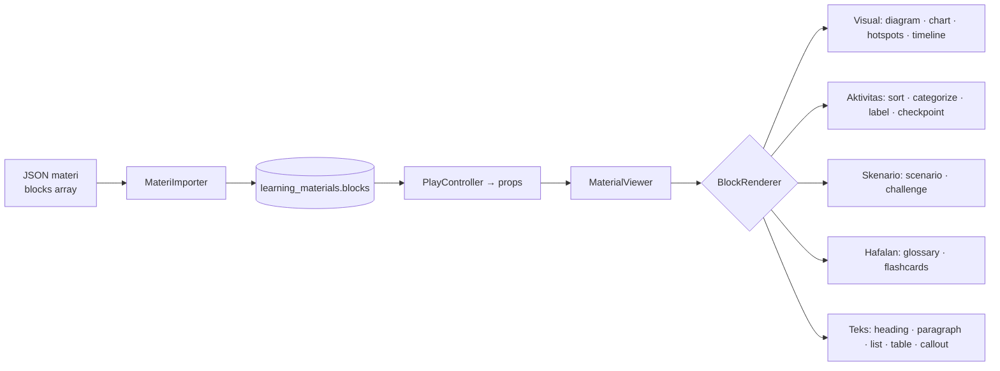
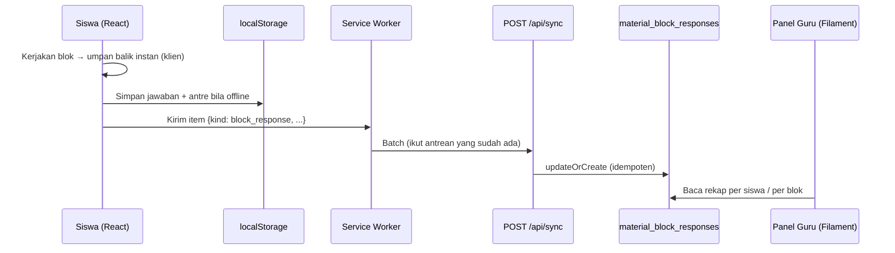

# Rencana: Materi Pembelajaran Interaktif (Visual Learning, Drag & Drop, Kuis Interaktif, Skenario, Puzzle, Tantangan)

**Disusun:** 16 November 2026
**Status:** 🟡 Rencana — belum ada implementasi
**Keputusan konten:** (1) Gambar `hotspots` **diekstrak dari PDF buku ajar**; (2) skor blok interaktif **disimpan untuk siswa dan guru** (bukan hanya lokal)
**Lokasi proyek:** `C:\laragon\www\gamecenter\gamecenter`
**Sumber materi:** `data/kurmer/SMKSMA/` → diolah menjadi `gamecenter/database/seeders/data/sma-smk/fase-e/<mapel>/*.json`
**Versi aplikasi acuan:** 0.18.0

---

## 0. Ringkasan Satu Halaman

Saat ini materi di folder `data/` (buku ajar PDF, modul ajar DOCX, CP/ATP/KKTP/PROSEM/PROTA)
sudah dikonversi menjadi **49 berkas JSON** berisi **146 materi** dan **1.440 soal**.
Masalahnya: **112 dari 146 materi bertipe `text`** — hanya markdown biasa yang dibaca
seperti buku digital. Sisanya `interactive`, tetapi "interactive" saat ini hanya berarti
markdown yang mengandung `<details><summary>` (accordion buka-tutup). Belum ada visual
learning, belum ada drag & drop di dalam materi, belum ada skenario bercabang, belum ada
tantangan berjenjang.

Rencana ini mengubah materi dari **"teks yang bisa dibuka-tutup"** menjadi **7 format
pembelajaran interaktif** yang dibangun di atas `learning_materials.blocks` (kolom JSON
yang **sudah ada** dan **sudah diimpor** oleh `MateriImporter`). Artinya: **tidak perlu
migrasi database untuk fitur inti** — cukup menambah tipe blok, renderer React, dan
validasi skema.

| Format | Nama internal | Tujuan pedagogis | Basis riset |
|---|---|---|---|
| Visual learning | `diagram`, `chart`, `hotspots`, `timeline` | Memahami struktur & hubungan konsep | Mayer *multimedia principle* (d≈1,67) |
| Drag & drop | `sort`, `label`, `categorize` | Latihan klasifikasi & prosedur | H5P Drag&Drop / Sort the Paragraphs |
| Kuis interaktif | `checkpoint` | Umpan balik formatif di tengah materi | Clinton-Lisell dkk. g=0,66 |
| Scenario based | `scenario` (branching) | Transfer ke situasi nyata | H5P Branching Scenario |
| Puzzle | `puzzle` (jigsaw/urutan) | Memahami sequence & struktur | H5P Image Sequencing |
| Tantangan | `challenge` | Motivasi & pengulangan terarah | Özdemir (Kahoot!) g=0,772 |
| Flashcard / hafalan | `flashcards`, `glossary` | Retrieval practice | H5P Dialog Cards |

**Target akhir:** setiap bab punya **minimal 1 materi visual + 1 aktivitas interaktif +
1 checkpoint**, sehingga pola 60% materi → soal tidak lagi berupa "baca 4 menit lalu ujian".

### 0.1 Dua keputusan yang sudah ditetapkan

| Keputusan | Dampak pada rencana |
|---|---|
| **Gambar `hotspots`/`label`/jigsaw diekstrak dari PDF buku ajar** (bukan digambar ulang) | Tambah **Fase 0**: pipeline ekstraksi PyMuPDF → `public/media/`, manifest aset, jejak `book`+`page` pada setiap blok visual, dan catatan risiko hak cipta (§6.0, §8) |
| **Skor blok interaktif disimpan untuk siswa dan guru** (bukan hanya `localStorage`) | Tambah tabel **`material_block_responses`** + perluasan `SyncService` di **Fase 2**, serta rekap + ekspor di panel Filament pada **Fase 5** (§3.4) |

Keduanya membuat Fase 2 lebih besar dari rencana awal — lihat §6.

---

## 1. Kondisi Saat Ini (Baseline Terukur)

### 1.1 Isi folder `data/`

| Folder | Berkas | Ekstensi | Kegunaan |
|---|---|---|---|
| `data/kurmer/SMKSMA/BUKU AJAR/` | 88 | `.pdf` | Teks asli, gambar, tabel, latihan |
| `data/kurmer/SMKSMA/{CP,ATP,KKTP,PROSEM,PROTA}/` | 137 | `.docx`, `.doc` | Tujuan pembelajaran, alur, kriteria ketuntasan |
| `data/kurmer/SMKSMA/MAPEL/` | 48 | `.ini` | Metadata mapel |
| **Total** | **499** | | |

### 1.2 Hasil konversi saat ini

| Metrik | Jumlah | Catatan |
|---|---|---|
| Berkas JSON materi | 49 | `gamecenter/database/seeders/data/sma-smk/fase-e/` |
| Chapter | 49 | 8 mapel: Matematika 13, Informatika 8, PAI 10, Pancasila 4, Bahasa Indonesia 5, Fisika 2, Kimia 3, Biologi 3 |
| Materi | 146 | **112 `text`** + 34 `interactive` |
| Soal | 1.440 | `multiple_choice` 1.190 · `multiple_answer` 97 · `drag_drop` 56 · `matching` 50 · `puzzle` 47 |
| Soal non-pilihan-ganda | 250 (17 %) | Target plan sebelumnya: ≥30 % |

### 1.3 Masalah yang ingin diselesaikan

1. **Materi masih pasif.** `MaterialViewer.tsx` hanya mem-parse markdown menjadi
   heading/list/tabel/paragraf/kode. Tidak ada elemen yang bisa disentuh.
2. **`type: "interactive"` menipu.** Tidak ada renderer khusus — `interactive`
   dirender sama seperti `text` (ikon 🧩 saja yang berbeda).
3. **`blocks` kosong.** Kolom `learning_materials.blocks` (json, nullable) sudah
   diimpor tetapi **belum pernah diisi** oleh berkas JSON mana pun dan **belum
   pernah dirender** oleh React. Ini "lahan kosong" yang ideal.
4. **Kuis hanya di akhir.** Umpan balik formatif baru muncul setelah sesi selesai,
   padahal riset menunjukkan *questions with feedback* adalah komponen interaktif
   yang paling berkontribusi pada pemahaman bacaan.
5. **Visual tidak ada.** Tidak ada SVG, diagram, chart, atau hotspot gambar, padahal
   banyak materi (fungsi kuadrat, vektor, trigonometri, struktur atom, siklus iklim)
   sulit dipahami tanpa visual.

### 1.4 Aset yang sudah tersedia (tidak perlu dibangun ulang)

| Komponen | Lokasi | Dapat dipakai untuk |
|---|---|---|
| `MaterialViewer` + `parseBlocks` | `resources/js/Components/Game/MaterialViewer.tsx` | Titik sisip renderer blok interaktif |
| `DragDropGame` | `resources/js/Components/Game/DragDropGame.tsx` | Pola drag & drop urutan (HTML5 DnD) |
| `MatchGame` | `resources/js/Components/Game/MatchGame.tsx` | Pola menjodohkan dua kolom |
| `SimulationGame` | `resources/js/Components/Game/SimulationGame.tsx` | Pola input terstruktur |
| `game-engine.ts` | `resources/js/lib/game/game-engine.ts` | Evaluasi, `shuffleWithSeed`, `orderingPieces`, `matchingPairs` |
| `MateriSchema` | `app/Services/Materi/MateriSchema.php` | Validasi sisi server (perluas untuk blok) |
| `MateriImporter` | `app/Services/Materi/MateriImporter.php` | Sudah menyimpan `blocks` apa adanya |
| `mermaid` 12.3 | `package.json` | Diagram alur (sudah terpasang, dipakai halaman panduan) |

---

## 2. Landasan Riset (Kenapa Format Ini)

Riset berikut dipakai sebagai justifikasi desain, bukan sekadar hiasan.

| Temuan | Angka | Implikasi untuk gamecenter |
|---|---|---|
| Clark, Tanner-Smith & Killingsworth (2016), *Review of Educational Research* 86(1) | g = 0,33 game vs non-game; g = 0,34 untuk desain game yang "diperkaya" (value-added) | **Desain mekanik menentukan hasil**, bukan medium. Menambah interaksi ke materi = *value-added design* |
| Wouters dkk. (2013), *J. Educational Psychology* | d = 0,29 belajar, **d = 0,36 retensi**; efek lebih besar bila game **disertai instruksi lain** dan **kerja kelompok** | Materi interaktif harus berdampingan dengan teks pengantar, bukan menggantikannya. Mode kelompok sudah ada → manfaatkan |
| Gui dkk. (2023), *Int. J. STEM Education* | g = 0,624 game digital STEM; g = 0,301 untuk penambahan elemen desain game | Untuk Matematika/Fisika/Kimia/Biologi (26 chapter dari 49), game-based terbukti kuat |
| Özdemir (2025), *J. Computer Assisted Learning* | Kahoot! efek 0,772 pada prestasi akademik | Format kuis berpoin + timer + leaderboard layak ditiru untuk `challenge` |
| Clinton-Lisell dkk. (2023), *Interactive Learning Environments* 31(6) | Fitur interaktif e-text: **g = 0,66**; fitur paling berpengaruh: **pertanyaan dengan umpan balik**, glosarium digital, alat kolaborasi | Prioritas #1: `checkpoint` (soal di tengah materi) dan `glossary` |
| Mayer (2017), *J. Computer Assisted Learning* | *Multimedia principle* d = 1,67; *segmenting* d = 0,70; *pre-training* d = 0,46; *signaling* d = 0,46; *coherence* d = 0,70 | Setiap materi = kata + gambar relevan, dipecah menjadi segmen kecil, tanpa hiasan berlebih |
| Moreno & Mayer (2007) | Prinsip *guided activity, reflection, feedback, control, pretraining* | Materi interaktif wajib punya umpan balik dan kendali pada siswa (bisa ulangi, bisa lewati) |

### 2.1 Tujuh prinsip desain yang mengikat semua format

1. **Coherence** — buang hiasan yang tidak menambah pemahaman. Tidak ada animasi dekoratif.
2. **Signaling** — sorot bagian penting (highlight kata kunci, panah, angka kunci).
3. **Segmenting** — pecah materi panjang menjadi blok 1–3 menit, bukan satu dinding teks.
4. **Pre-training** — sebelum aktivitas sulit, tampilkan `glossary` istilah kunci.
5. **Feedback** — setiap interaksi langsung memberi umpan balik benar/salah + alasan.
6. **Control** — siswa bisa mengulang aktivitas tanpa kehilangan progres.
7. **Accessibility** — semua interaksi punya jalur keyboard dan `aria-*`; drag & drop
   **wajib** punya alternatif tombol Atas/Bawah.

> Tanpa prinsip 7, drag & drop akan gagal untuk siswa pengguna keyboard dan pembaca layar.
> Ini bukan opsional — lihat §7.

---

## 3. Arsitektur Solusi

### 3.1 Keputusan inti

| Keputusan | Alasan |
|---|---|
| **Memakai `learning_materials.blocks` yang sudah ada**, bukan tabel baru | Kolom sudah ada, sudah diimpor, sudah dikirim ke klien. Tidak perlu migrasi untuk fitur inti |
| **Blok = data, renderer = kode** | Materi tetap JSON murni (sumber kebenaran), sehingga bisa diaudit dan diimpor ulang idempoten |
| **Renderer dipisah per tipe blok** di `resources/js/Components/Material/Blocks/` | Satu blok = satu berkas, mudah diuji, mudah ditambah |
| **Tidak menambah dependensi berat** | `mermaid` sudah ada untuk diagram. Untuk drag & drop: pakai ulang HTML5 DnD yang sudah terbukti di `DragDropGame`, **atau** `@dnd-kit` bila kebutuhan aksesibilitas menuntut (lihat §7.3) |
| **Penilaian blok di klien, penyimpanan di server** | Jawaban dinilai seketika di klien (umpan balik instan), lalu dikirim dan disimpan lewat `/api/sync` agar siswa & guru bisa melihatnya. Blok **tidak** menambah skor sesi resmi |
| **Aset visual diekstrak dari PDF buku ajar** | Sesuai keputusan pemilik proyek: gambar asli buku dipakai untuk `hotspots`/`label`/`puzzle` jigsaw, dengan pencatatan sumber `page` + `source_book` pada aset |
| **`type` materi diperluas** | `text`, `interactive`, `visual`, `scenario`, `game` — memberi tahu UI cara merangkai blok |

### 3.2 Skema blok (JSON)

`blocks` adalah **array berurutan**; renderer merangkai dari atas ke bawah. Setiap blok
punya `type` dan `id` unik di dalam materi.

```jsonc
"blocks": [
  { "type": "heading",     "level": 2, "text": "Empat Pilar Berpikir Komputasional" },
  { "type": "paragraph",   "text": "Berpikir komputasional menyusun solusi secara sistematis." },
  { "type": "callout",     "tone": "info", "text": "Keempat pilar bekerja berurutan." },
  { "type": "diagram",     "engine": "mermaid", "code": "flowchart LR\n  A[Dekomposisi] --> B[Pola]\n  B --> C[Abstraksi]\n  C --> D[Algoritma]" },
  { "type": "chart",       "kind": "bar", "title": "Contoh", "data": [ {"label":"A","value":12} ] },

  { "type": "hotspots", "id": "hs-1",
    "image_url": "/media/informatika/pilar.svg",
    "caption": "Klik tiap bagian untuk penjelasan",
    "points": [ { "id": "p1", "x": 0.22, "y": 0.41, "label": "Dekomposisi", "body": "Memecah masalah besar." } ] },

  { "type": "timeline", "id": "tl-1",
    "items": [ { "when": "1950", "title": "..." , "body": "..." } ] },

  { "type": "glossary", "id": "gl-1",
    "terms": [ { "term": "Dekomposisi", "definition": "Memecah masalah besar menjadi bagian kecil." } ] },

  { "type": "flashcards", "id": "fc-1",
    "cards": [ { "front": "Apa itu abstraksi?", "back": "Menyaring detail yang tidak perlu." } ] },

  { "type": "sort", "id": "srt-1",
    "prompt": "Urutkan langkah berpikir komputasional.",
    "items": [ { "id": "a", "text": "Pahami masalah" }, { "id": "b", "text": "Pecah masalah" } ],
    "answer": ["a", "b"],
    "feedback": { "correct": "Tepat.", "wrong": "Mulai dari memahami masalah dulu." } },

  { "type": "categorize", "id": "cat-1",
    "prompt": "Kelompokkan ciri berikut.",
    "buckets": [ { "id": "b1", "label": "Fakta" }, { "id": "b2", "label": "Opini" } ],
    "items": [ { "id": "i1", "text": "Air mendidih pada 100 °C", "bucket": "b1" } ] },

  { "type": "label", "id": "lbl-1",
    "prompt": "Beri nama bagian diagram.",
    "image_url": "/media/fisika/vektor.svg",
    "targets": [ { "id": "t1", "x": 0.3, "y": 0.2, "answer": "resultan" } ],
    "choices": ["resultan", "komponen x", "komponen y"] },

  { "type": "checkpoint", "id": "cp-1",
    "question": "Langkah pertama berpikir komputasional adalah…",
    "choices": [ { "id": "c1", "text": "Dekomposisi", "correct": true }, { "id": "c2", "text": "Abstraksi" } ],
    "explanation": "Masalah harus dipahami dan dipecah lebih dulu." },

  { "type": "scenario", "id": "sc-1",
    "title": "Kamu ketua panitia kegiatan sekolah",
    "start": "n1",
    "nodes": [
      { "id": "n1", "text": "Panitia hanya 5 orang, tugas 20. Apa langkahmu?",
        "choices": [
          { "text": "Pecah tugas per bidang", "next": "n2", "score": 2 },
          { "text": "Kerjakan semua sendiri", "next": "n3", "score": 0 } ] },
      { "id": "n2", "text": "Tepat. Kamu memakai dekomposisi.", "end": true, "outcome": "good" },
      { "id": "n3", "text": "Kelelahan dan hasil tidak maksimal.", "end": true, "outcome": "bad" }
    ] },

  { "type": "challenge", "id": "ch-1",
    "title": "Tantangan Kilat",
    "time_limit": 90,
    "items": [
      { "question": "Istilah untuk menyaring detail…", "answer": "abstraksi" },
      { "question": "Istilah untuk menemukan kesamaan…", "answer": "pola" }
    ] }
]
```

Aturan skema:
- `id` blok wajib unik dalam satu materi, dipakai untuk menyimpan jawaban siswa lokal.
- Blok aktivitas (`sort`, `categorize`, `label`, `checkpoint`, `scenario`, `challenge`)
  **wajib** punya `feedback` dan **tidak boleh** menentukan skor sesi resmi.
- Blok visual (`diagram`, `chart`, `hotspots`, `timeline`) **tidak** dinilai.
- Semua teks memakai Unicode untuk simbol matematika (`²`, `×`, `√`), bukan LaTeX —
  konsisten dengan aturan impor yang berlaku.

### 3.3 Alur render



Poin penting: **`MaterialViewer.parseBlocks` tetap dipakai** untuk materi `text` lama
(backward compatible). Bila `material.blocks` tidak kosong, blok dipakai; bila kosong,
markdown diparse seperti sekarang. Tidak ada materi lama yang rusak.

### 3.4 Perubahan skema server yang diperlukan (minimal)

| Perubahan | Berkas | Alasan |
|---|---|---|
| Tambah nilai `visual`, `scenario` ke `MaterialType` | `app/Enums/MaterialType.php` | Materi tipe baru butuh label & ikon |
| Validasi `blocks` di `MateriSchema` | `app/Services/Materi/MateriSchema.php` | Mencegah blok rusak masuk database |
| **Migrasi `material_block_responses`** | migrasi baru `2026_11_17_000000_create_material_block_responses_table.php` | **Wajib** — skor blok harus terlihat siswa & guru, jadi tidak boleh hanya di `localStorage` |
| **Endpoint sinkron blok** | `SyncService` + `Api/SyncController` | Mengirim jawaban blok memakai antrean offline yang sudah ada |
| Kolom `blocks_version` *(opsional)* | migrasi baru | Hanya bila ingin evolusi skema blok yang aman |

### 3.4.1 Tabel `material_block_responses`

Satu baris = satu **blok** yang dikerjakan seorang siswa pada satu materi. Blok dengan
beberapa butir (`challenge`, `scenario`) menyimpan rincian di `details`.

```php
Schema::create('material_block_responses', function (Blueprint $table) {
    $table->id();
    $table->foreignId('user_id')->constrained()->cascadeOnDelete();
    $table->foreignId('material_id')->constrained('learning_materials')->cascadeOnDelete();

    $table->string('block_id', 64);          // id blok di dalam JSON materi
    $table->string('block_type', 32);        // sort, categorize, checkpoint, scenario, ...

    $table->unsignedSmallInteger('score')->default(0);      // 0..100 untuk blok ini
    $table->unsignedSmallInteger('max_score')->default(100);
    $table->unsignedSmallInteger('attempts')->default(1);
    $table->boolean('is_completed')->default(false);

    $table->json('details')->nullable();      // jawaban mentah per butir (untuk pembahasan guru)
    $table->timestamp('first_completed_at')->nullable();
    $table->timestamp('last_answered_at')->nullable();
    $table->timestamps();

    $table->unique(['user_id', 'material_id', 'block_id']);   // kunci idempotensi sync
    $table->index(['user_id', 'block_type']);
    $table->index(['material_id', 'block_type']);
});
```

Aturan penyimpanan:

- **Idempoten**: kunci unik `(user_id, material_id, block_id)` membuat kiriman ulang dari
  antrean offline tidak menggandakan baris (`updateOrCreate`).
- **Skor blok ≠ skor sesi.** `game_sessions.total_score` tetap dihitung server dari
  `assessments`. Skor blok adalah **formatif** dan ditampilkan terpisah di `/progres` dan
  panel guru.
- **Kebijakan percobaan**: `attempts` bertambah setiap kali siswa menekan Periksa;
  `score` menyimpan **nilai terbaik**, `details` menyimpan percobaan terakhir + jumlah
  percobaan per butir. Guru melihat "butir mana yang paling sering salah", bukan sekadar
  angka akhir.
- **Tidak menyimpan data sensitif**: hanya `block_id`, skor, dan jawaban. Tidak ada
  catatan waktu per klik kecuali untuk `challenge` (durasi).

### 3.4.2 Alur pengiriman skor blok



**Rekomendasi:** pakai ulang `sync_queue` dan `/api/sync` yang **sudah ada** dengan
menambah jenis item baru (`kind: "material_block"`). Tidak perlu endpoint baru — cukup
perluas validator `SyncService` dan dokumentasikan bentuk payload-nya.

---

## 4. Rincian Tujuh Format

Untuk setiap format: tujuan, bentuk data, komponen, dan contoh penerapan ke mapel nyata
yang sudah ada di `database/seeders/data/sma-smk/fase-e/`.

### 4.1 Visual Learning

**Tujuan:** membuat konsep abstrak terlihat. Mengikuti *multimedia principle* (d≈1,67)
dan *spatial contiguity* (teks menempel pada gambar, d≈0,79).

| Blok | Bentuk | Kapan dipakai |
|---|---|---|
| `diagram` | Mermaid (`flowchart`, `sequenceDiagram`, `mindmap`) | Alur prosedur, hierarki, siklus, relasi |
| `chart` | Data sederhana → SVG/CSS chart tanpa library | Data proporsi, perbandingan, tren |
| `hotspots` | `image_url` + titik `x/y` ternormalisasi 0..1 | Diagram berlabel, peta, anatomi, sirkuit |

**Sumber gambar: diekstrak dari PDF buku ajar** (keputusan proyek).
Setiap aset wajib menyimpan jejak sumber agar dapat diaudit:

```jsonc
{ "type": "hotspots", "id": "hs-1",
  "image_url": "/media/informatika/inf-1/p033-x400.png",
  "image_source": { "book": "Informatika-BS-KLS-X.pdf", "page": 33, "figure": "Gambar 2.3" },
  "caption": "Empat pilar berpikir komputasional",
  "points": [ ... ] }
```

Pipeline ekstraksi (§6.0) menghasilkan PNG dari halaman PDF, mencatat nomor halaman, dan
menyimpan daftar aset pada berkas manifest agar bisa dibuat ulang.
| `timeline` | Daftar `when/title/body` | Sejarah, kronologi, tahapan proses |

**Contoh penerapan nyata:**
- `ma-6.1-karakteristik-fungsi-kuadrat.json` → `chart` parabola + `hotspots` pada
  titik puncak, sumbu simetri, akar.
- `fis-1-pengukuran-kerja-ilmiah.json` → `hotspots` jangka sorong (skala utama, nonius).
- `kim-1-struktur-atom-nanoteknologi.json` → `diagram` model atom + `timeline` sejarah model.
- `bio-3-perubahan-iklim.json` → `diagram` siklus karbon.
- `pai-10-wali-songo.json` → `timeline` kronologi penyebaran Islam.

**Aturan aksesibilitas:** setiap `hotspots`/`chart`/`diagram` **wajib** punya
`caption` atau teks alternatif setara. Angka `x/y` ternormalisasi (0..1) agar gambar
hasil ekstraksi dengan resolusi berbeda tetap akurat.

> **Catatan hak cipta** — lihat tabel risiko pada §8 (baris "Hak cipta gambar hasil ekstraksi
> PDF"). Gambar dari buku Kemendikdasmen dipakai untuk pembelajaran non-komersial dengan
> atribusi sumber; tetap dicatat `book`+`page` agar penelusuran dan penghapusan mudah bila
> diperlukan.

### 4.2 Drag & Drop

**Tujuan:** latihan klasifikasi dan prosedur — jauh lebih efektif daripada membaca urutan
yang sama sebagai daftar bernomor.

| Blok | Mekanik | Padanan H5P |
|---|---|---|
| `sort` | Urutkan item (vertikal atau horizontal) | Sort the Paragraphs |
| `categorize` | Masukkan item ke keranjang | Drag and Drop |
| `label` | Tempel label ke posisi pada gambar | Find the Hotspot / Drag and Drop |

Pola implementasi mengikuti `DragDropGame.tsx`:
- `onDragStart` / `onDragOver` / `onDrop` (HTML5), tanpa library.
- **Wajib** ada tombol `↑` `↓` (atau tombol pilih-keranjang) untuk keyboard dan layar sentuh.
- Setelah "Periksa", item yang salah ditandai merah dan **boleh diulang** (prinsip *control*).
- Umpan balik per item, bukan hanya total.

**Contoh penerapan:**
- `bi-1-...` → `sort` struktur teks laporan hasil observasi.
- `kim-2-hukum-dasar-kimia.json` → `categorize` hukum Lavoisier/Proust/Dalton.
- `inf-4-jaringan-komputer-internet.json` → `label` perangkat pada topologi jaringan.
- `pan-2-budaya-taat-hukum.json` → `categorize` perilaku taat hukum vs melanggar.

### 4.3 Kuis Interaktif (`checkpoint`)

**Tujuan:** *retrieval practice* + umpan balik segera di tengah materi. Ini fitur dengan
efek terbesar menurut meta-analisis e-text (g=0,66), dan *knowledge-of-correct-response*
feedback terbukti kritis untuk hasil belajar.

Aturan:
- Maksimal **1 checkpoint per 400–600 kata** (prinsip *segmenting*).
- Umpan balik selalu menjelaskan **mengapa**, bukan hanya "benar/salah".
- Boleh diulang tanpa batas; percobaan pertama dicatat sebagai metrik.
- Tidak masuk skor sesi (asesmen resmi tetap di `assessments`).

**Contoh:** setiap bab di `pancasila/`, `pai/`, dan `bahasa-indonesia/` mendapat 2–3
checkpoint di antara blok teks.

### 4.4 Scenario Based Learning (`scenario`)

**Tujuan:** transfer ke situasi nyata, berpikir kritis, dan pengambilan keputusan.
Model: **graf bercabang** (node → pilihan → node), mengikuti H5P Branching Scenario.

Struktur:
```jsonc
{ "type": "scenario", "id": "sc-1", "title": "...", "start": "n1",
  "nodes": [
    { "id": "n1", "text": "...", "choices": [ { "text": "...", "next": "n2", "score": 2, "feedback": "..." } ] },
    { "id": "n2", "text": "...", "end": true, "outcome": "good" }
  ] }
```

Aturan:
- Setiap node **wajib** punya minimal satu jalan keluar (`next` atau `end`).
- Graf **tidak boleh** punya siklus tak berujung — validator memeriksa reachability dan
  memastikan setiap node bisa mencapai `end`.
- Di akhir: tampilkan ringkasan keputusan + skor pembentukan karakter (bukan nilai akademik).
- Cocok untuk mapel non-eksakta: Pancasila, PAI, Bahasa Indonesia, IPS, PJOK, Prakarya.

**Contoh penerapan:**
- `pan-1-pancasila-pemersatu-bangsa.json` → skenario "rapat kelas dengan perbedaan pendapat".
- `pan-3-mengelola-kebinekaan.json` → skenario "menanggapi ujaran kebencian di grup daring".
- `pai-6-pergaulan-bebas-dan-zina.json` → skenario "menolak ajakan melanggar norma".
- `pai-4-asuransi-bank-koperasi-syariah.json` → skenario "memilih produk keuangan".
- `bi-1-laporan-hasil-observasi.json` → skenario "menghadapi data yang tidak konsisten".

### 4.5 Puzzle

**Tujuan:** memahami struktur dan urutan dengan cara yang menuntut, lebih dari sekadar
membaca. Ada dua bentuk:

| Bentuk | Mekanik | Contoh |
|---|---|---|
| Urutan (`sort`)| Sama seperti drag & drop urutan, tetapi item berupa potongan teks/kode | `ma-1.1-eksponen.json` → urutan langkah penyelesaian |
| Jigsaw visual | Potongan gambar (`image_url` + `rows`/`cols`) disusun | `bio-2-keanekaragaman-hayati.json` → susun siklus |
| Isi rumpang | `fill_blanks` di dalam paragraf | `bi-4-teks-negosiasi.json` → istilah negosiasi |

> Catatan: tipe soal `puzzle` **sudah ada** di `QuestionType` (47 soal) dan dinilai di
> `game-engine.ts`. Blok puzzle di materi adalah **versi latihan**, bukan pengganti soal.

### 4.6 Tantangan (`challenge`)

**Tujuan:** motivasi melalui tekanan waktu ringan + pengulangan (Kahoot! g=0,772).

Aturan:
- Timer pendek (60–120 detik), isi 5–8 butir singkat (istilah, rumus, tanggal).
- Bisa dimainkan berulang; simpan **rekor pribadi** di `localStorage`.
- **Tidak** masuk skor resmi; murni latihan mandiri.
- Umpan balik akhir: butir mana yang salah + tautan ke blok terkait.
- Mode kelompok (sudah ada di aplikasi) dapat memakai `challenge` sebagai ronde pemanasan.

**Contoh penerapan:** satu `challenge` di akhir setiap bab Matematika dan IPA
(istilah/rumus), satu di akhir bab PAI (istilah Arab & artinya).

### 4.7 Hafalan: `glossary` & `flashcards`

**Tujuan:** *pre-training* (d≈0,46) dan *retrieval practice*.

- `glossary`: daftar istilah yang bisa diklik → definisi muncul sebaris. Diletakkan di
  **awal** bab (pre-training) dan dipakai ulang sebagai *digital glossary* (salah satu
  fitur dengan efek positif pada meta-analisis e-text).
- `flashcards`: kartu depan/belakang dengan sistem "Ulangi / Sudah ingat" (Leitner
  sederhana 3 kotak, disimpan di `localStorage`).

**Contoh:** `kim-3-kimia-hijau.json` (glosarium istilah hijau), `inf-2-tik.json`
(glosarium perangkat TIK), `pai-2-syuabul-iman.json` (glosarium istilah iman).

---

## 5. Pemetaan ke Materi yang Sudah Ada

Prioritas berdasarkan jenis mapel dan ketersediaan visual.

### 5.1 Gelombang 1 — Mapel eksakta (visual paling berdampak)

| Mapel | Chapter | Blok yang ditambahkan |
|---|---|---|
| Matematika | 13 | `chart` + `hotspots` (fungsi, vektor, trigonometri), `sort` (langkah penyelesaian), `checkpoint`, `challenge` |
| Fisika | 2 | `hotspots` (alat ukur), `diagram` (energi), `checkpoint` |
| Kimia | 3 | `diagram` (atom, reaksi), `categorize` (hukum dasar), `glossary` |
| Biologi | 3 | `diagram` (siklus, klasifikasi), `hotspots` (sel), `sort` (tahapan) |

### 5.2 Gelombang 2 — Mapel sosial & humaniora (skenario paling berdampak)

| Mapel | Chapter | Blok yang ditambahkan |
|---|---|---|
| Pancasila | 4 | `scenario` (2–3 per bab), `categorize`, `checkpoint` |
| PAI | 10 | `scenario`, `glossary`, `timeline` (Wali Songo, ulama), `flashcards` |
| Bahasa Indonesia | 5 | `sort` (struktur teks), `fill_blanks`, `categorize` fakta/opini, `scenario` |
| Informatika | 8 | `diagram` (algoritma, jaringan), `sort`, `label`, `challenge` |

### 5.3 Aturan konversi per bab

Setiap bab yang dikonversi **wajib** memenuhi minimum berikut:

| Komponen | Minimum |
|---|---|
| Blok visual (`diagram`/`chart`/`hotspots`/`timeline`) | 1 |
| Blok aktivitas (`sort`/`categorize`/`label`/`checkpoint`) | 2 |
| `checkpoint` | per 400–600 kata teks |
| `glossary` atau `flashcards` | 1 |
| Skenario atau tantangan | 1 (untuk mapel non-eksakta / eksakta) |
| Teks asli yang dipertahankan | **100 %** — tidak boleh ada fakta yang hilang |

Prinsip: **tidak ada konten yang dibuang.** Blok baru *membungkus* dan *memecah* teks
yang sudah ada, bukan menggantikannya. Ini menjaga kesetiaan pada modul ajar
(`source_reference` tetap).

---

## 6. Tahapan Implementasi

### Fase 0 — Pipeline Aset Gambar dari PDF (keputusan #1)

Dieksekusi sebelum Fase 3, tetapi alatnya dibuat sekarang agar konten bisa disiapkan paralel.

| # | Pekerjaan | Berkas |
|---|---|---|
| 0.1 | Skrip ekstraksi gambar per halaman (`PyMuPDF`) | `tools/pdf-extract-images.py` |
| 0.2 | Penyaring kualitas: `min 200×200 px`, buang gambar < 2 KB, konversi CMYK→RGB | dalam skrip |
| 0.3 | Manifest aset: `book`, `page`, `xref`, `w`, `h`, `file`, `checksum` | `tools/out/asset-manifest.json` |
| 0.4 | Salin aset terpilih ke `gamecenter/public/media/<mapel>/<kode-bab>/` | skrip + tinjau manual |
| 0.5 | Daftarkan `public/media/` pada service worker agar ikut cache offline | `public/sw.js` |
| 0.6 | Dokumentasi cara menjalankan ulang ekstraksi | `doc/aset-gambar.md` |

Verifikasi yang sudah dilakukan pada rencana ini (bukan asumsi):

| Uji | Hasil |
|---|---|
| `PyMuPDF 2.1` terpasang / dapat diunduh | ✅ |
| `Informatika-BS-KLS-X.pdf` terbaca | ✅ 272 halaman |
| Gambar ditemukan | ✅ 373 gambar di 150 halaman |
| Ekstraksi PNG nyata | ✅ contoh `345×466 px` (221 KB) dan `205×205 px` (42 KB) |
| `pdftotext` tersedia untuk rujukan teks | ✅ `/mingw64/bin/pdftotext` |

Bentuk perintah (mengikuti uji yang sudah berhasil):

```bash
python tools/pdf-extract-images.py \
  "data/kurmer/SMKSMA/BUKU AJAR/KELAS X/Informatika-BS-KLS-X.pdf" \
  --out gamecenter/public/media/informatika/inf-1 \
  --min-size 200 --pages 30-45 --manifest tools/out/inf-1.json
```

Aturan: **hanya aset yang masuk manifest yang boleh dipakai**. Aset tanpa `book` + `page`
ditolak oleh validator materi.

### Fase 1 — Fondasi Renderer (tanpa perubahan konten)

| # | Pekerjaan | Berkas |
|---|---|---|
| 1.1 | Definisikan tipe TypeScript blok (`MaterialBlock` union) | `resources/js/lib/material/blocks.ts` |
| 1.2 | `BlockRenderer` yang memilih komponen berdasarkan `type` | `resources/js/Components/Material/BlockRenderer.tsx` |
| 1.3 | Blok teks: `heading`, `paragraph`, `list`, `table`, `callout` | `.../Blocks/TextBlocks.tsx` |
| 1.4 | Integrasikan ke `MaterialViewer`: pakai `blocks` bila ada, jika tidak fallback markdown | `MaterialViewer.tsx` |
| 1.5 | Perluas `MaterialType` (`visual`, `scenario`) + ikon | `app/Enums/MaterialType.php`, `MaterialViewer.tsx` |
| 1.6 | Tes: materi lama tetap tampil identik | `tests/Feature/PlayPageTest.php` |

**Selesai bila:** materi `text` lama tampil tanpa perubahan, dan satu materi contoh
dengan `blocks` sederhana tampil benar.

### Fase 2 — Blok Interaktif Dasar

| # | Pekerjaan | Berkas |
|---|---|---|
| 2.1 | `glossary` + `flashcards` (paling aman, tanpa penilaian) | `.../Blocks/RecallBlocks.tsx` |
| 2.2 | `checkpoint` (pilihan tunggal + penjelasan) | `.../Blocks/CheckpointBlock.tsx` |
| 2.3 | `sort` + `categorize` (HTML5 DnD + tombol keyboard) | `.../Blocks/DragSortBlock.tsx` |
| 2.4 | Penyimpanan jawaban blok di `localStorage` per materi | `resources/js/lib/material/store.ts` |
| 2.5 | Validasi `blocks` di `MateriSchema` (bentuk + feedback wajib + `image_source`) | `app/Services/Materi/MateriSchema.php` |
| 2.6 | **Migrasi `material_block_responses`** + model `MaterialBlockResponse` | `database/migrations/`, `app/Models/` |
| 2.7 | **Perluas `SyncService`** untuk item `kind: "material_block"` (validasi + `updateOrCreate`) | `app/Services/SyncService.php` |
| 2.8 | Kirim jawaban blok lewat antrean sync (daring & luring) | `resources/js/lib/material/store.ts` |

**Selesai bila:** satu bab Informatika punya glossary + 2 checkpoint + 1 sort, skornya
muncul di `/progres` siswa **dan** tersimpan di server (lolos `gamecenter:materi-import`
sekaligus tes impor dan tes sync).

### Fase 3 — Visual Learning

| # | Pekerjaan | Berkas |
|---|---|---|
| 3.1 | `diagram` via Mermaid (lazy-load, fallback teks) | `.../Blocks/DiagramBlock.tsx` |
| 3.2 | `chart` SVG/CSS tanpa library (bar, line, pie sederhana) | `.../Blocks/ChartBlock.tsx` |
| 3.3 | `hotspots` + `label` (posisi ternormalisasi, responsif) | `.../Blocks/HotspotBlock.tsx` |
| 3.4 | `timeline` | `.../Blocks/TimelineBlock.tsx` |
| 3.5 | Aset gambar bab gelombang 1 di `public/media/<mapel>/` | aset baru |

**Selesai bila:** satu bab Matematika dan satu bab Fisika tampil lengkap dengan visual
dan tetap bisa dibuka offline (aset ikut service worker).

### Fase 4 — Skenario & Tantangan

| # | Pekerjaan | Berkas |
|---|---|---|
| 4.1 | `scenario` (graf bercabang, ringkasan keputusan) | `.../Blocks/ScenarioBlock.tsx` |
| 4.2 | `challenge` (timer, butir singkat, rekor lokal) | `.../Blocks/ChallengeBlock.tsx` |
| 4.3 | Validator graf skenario (tanpa siklus, semua node mencapai `end`) | `app/Services/Materi/ScenarioValidator.php` |
| 4.4 | Tes unit validator + tes render | `tests/Unit/ScenarioValidatorTest.php` |

**Selesai bila:** satu bab Pancasila punya skenario 3 tingkat dan satu bab Matematika
punya tantangan; validator menolak graf rusak.

### Fase 5 — Skala Konten, Rekap Guru & Analitik

| # | Pekerjaan | Catatan |
|---|---|---|
| 5.1 | Konversi seluruh 49 bab ke pola §5.3 | Pekerjaan konten terbesar |
| 5.2 | Panel Filament: pratinjau blok + peringatan blok rusak | `app/Filament` |
| 5.3 | **Halaman guru: rekap skor blok** per siswa & per blok (widget di `ChapterResource`) | `app/Filament/Resources/Chapters` |
| 5.4 | **Ekspor CSV skor blok** untuk guru | Filament action |
| 5.5 | Halaman siswa `/progres`: kartu "Latihan interaktif" (skor blok, bukan nilai rapor) | `resources/js/Pages/GameCenter/Progress.tsx` |

Catatan: tabel `material_block_responses` **tidak lagi opsional** — sudah dibuat di Fase 2
karena keputusan #2. Fase 5 hanya menambah tampilan dan ekspornya.

---

## 7. Aksesibilitas (Wajib, Bukan Opsional)

### 7.1 Standar yang diikuti

- **WCAG 2.2 Level AA** sebagai target minimum.
- `prefers-reduced-motion` dihormati: tidak ada animasi wajib.
- Kontras teks ≥ 4,5:1; elemen interaktif ≥ 3:1.

### 7.2 Aturan per komponen

| Komponen | Kewajiban |
|---|---|
| Semua blok | Punya heading semantik; urutan fokus logis |
| `diagram` | Teks alternatif setara (`desc`), bukan hanya gambar |
| `chart` | Tabel data tersembunyi untuk pembaca layar |
| `hotspots` | Titik dapat difokus, `aria-label`, daftar titik sebagai alternatif linear |
| `sort` / `categorize` | Tombol `↑`/`↓` atau pilih-keranjang; drag bukan satu-satunya jalan |
| `checkpoint` | `fieldset`/`legend`, umpan balik diumumkan `aria-live="polite"` |
| `scenario` | Setiap pilihan adalah `<button>`; riwayat keputusan dapat dibaca ulang |
| `challenge` | Timer **dapat dimatikan**; waktu tidak boleh jadi satu-satunya hambatan |
| `flashcards` | Dapat dibalik dengan Enter/Space |

### 7.3 Keputusan library drag & drop

| Opsi | Kelebihan | Kekurangan | Rekomendasi |
|---|---|---|---|
| HTML5 DnD manual (pola `DragDropGame`) | Nol dependensi, sudah terbukti di repo | Perlu kerja ekstra untuk keyboard & sentuh | **Pilihan default Fase 2** |
| `@dnd-kit` | Sensor keyboard & pointer siap, aksesibilitas lebih matang | +1 dependensi, kurva belajar | Bila kebutuhan keyboard/sentuh meluas di Fase 3+ |

Aturan: **jangan** memakai drag & drop sebagai satu-satunya cara memasukkan jawaban,
apa pun library-nya.

---

## 8. Risiko & Mitigasi

| Risiko | Dampak | Mitigasi |
|---|---|---|
| Beban kognitif berlebih (terlalu banyak interaksi) | Siswa lelah, materi tidak terbaca | Batasi 1 aktivitas per 400–600 kata (prinsip *segmenting* & *coherence*) |
| **Hak cipta gambar hasil ekstraksi PDF** | Masalah legal bila dipublikasikan komersial | Gunakan untuk pembelajaran non-komersial dengan atribusi; catat `book`, `page`, `figure` di setiap aset; siapkan manifest agar aset dapat ditarik/diganti cepat; alternatif: buat ulang diagram penting sebagai SVG sendiri |
| **Kualitas gambar ekstraksi buruk** (terlalu kecil, terpotong, resolusi rendah) | `hotspots` tidak terbaca, titik meleset | Penyaring ukuran minimum (≥200×200 px di §6.0), pratinjau manual sebelum dipakai, `x/y` ternormalisasi agar tetap akurat pada resolusi berbeda |
| **Gambar ekstrak berisi teks/halaman penuh, bukan ilustrasi** | Aset tidak relevan menumpuk | Ekstraksi per-halaman dengan laporan `page → xref → ukuran`; hanya aset yang masuk manifest yang diimpor |
| **Data skor blok membengkak / dobel saat sync** | Rekap guru kacau | Kunci unik `(user_id, material_id, block_id)` + `updateOrCreate` idempoten |
| **Siswa/guru mengira skor blok = nilai rapor** | Salah tafsir penilaian | Label eksplisit "latihan formatif — tidak masuk nilai" di UI siswa dan panel guru |
| Ukuran JSON membengkak | Muat awal lambat, cache IndexedDB penuh | Blok ringkas, gambar terkompresi, `diagram` dari kode (bukan gambar), pantau ukuran per bab |
| Materi lama rusak saat migrasi | Kehilangan konten | Fallback markdown bila `blocks` kosong; impor idempoten; tes regresi |
| Skor blok dianggap nilai resmi | Konflik penilaian guru | Blok bersifat formatif; skor sesi tetap dihitung server dari `assessments` |
| Drag & drop tidak bisa dipakai siswa keyboard | Siswa terhambat | Tombol alternatif wajib (§7.2) |
| Skenario bercabang jadi terlalu rumit | Sulit dirawat, banyak node mati | Validator graf + batas maksimum 15 node per skenario |
| Visual melanggar hak cipta | Masalah legal | Buat diagram sendiri (Mermaid/SVG); jangan menyalin gambar dari PDF buku |
| Aset visual memblokir mode offline | Fitur offline rusak | Daftarkan `public/media/` pada cache service worker |

---

## 9. Kriteria Keberhasilan (Terukur)

| Metrik | Sekarang | Target Fase 2 | Target Fase 4 |
|---|---|---|---|
| Materi dengan `blocks` | 0 / 146 | ≥ 8 bab | ≥ 49 bab |
| Materi dengan ≥1 blok visual | 0 | 2 bab | ≥ 40 bab |
| Materi dengan ≥1 aktivitas interaktif | 0 | 8 bab | ≥ 49 bab |
| Bab dengan skenario | 0 | 0 | ≥ 14 (Pancasila, PAI, B. Indonesia) |
| Checkpoint per 500 kata | 0 | ≥ 1 | ≥ 1 di semua bab |
| Soal non-pilihan-ganda | 17 % | 20 % | ≥ 30 % (target plan sebelumnya) |
| Skor blok tersimpan di server | 0 | ≥ 8 bab | ≥ 49 bab |
| Rekap skor blok terlihat guru | tidak ada | 1 halaman | per siswa + per blok |
| Aset gambar hasil ekstraksi PDF | 0 | 2 bab | ≥ 40 bab |
| Setiap aset punya `book` + `page` | — | 100 % | 100 % |
| Typecheck & tes | lulus | lulus | lulus |
| Materi lama tetap identik | — | ✅ | ✅ |

Metrik dampak (butuh data nyata, diukur terpisah): tingkat penyelesaian materi,
pengulangan blok, dan selisih skor asesmen sebelum/sesudah ada materi interaktif.

---

## 10. Referensi

### 10.1 Riset (dipakai sebagai dasar desain)

1. Clark, D. B., Tanner-Smith, E. E., & Killingsworth, S. S. (2016). Digital games, design, and learning: A systematic review and meta-analysis. *Review of Educational Research, 86*(1), 79–122. <https://doi.org/10.3102/0034654315582065> — <https://pmc.ncbi.nlm.nih.gov/articles/PMC4748544/>
2. Wouters, P., van Nimwegen, C., van Oostendorp, H., & van der Spek, E. D. (2013). A meta-analysis of the cognitive and motivational effects of serious games. *Journal of Educational Psychology, 105*(2), 249–265. <https://doi.org/10.1037/a0031311>
3. Gui, Y., Cai, Z., Yang, Y., Kong, L., Fan, X., & Tai, R. H. (2023). Effectiveness of digital educational game and game design in STEM learning: a meta-analytic review. *International Journal of STEM Education, 10*, 36. <https://doi.org/10.1186/s40594-023-00424-9>
4. Özdemir, O. (2025). Kahoot! Game-based digital learning platform: A comprehensive meta-analysis. *Journal of Computer Assisted Learning*. <https://doi.org/10.1111/jcal.13084>
5. Clinton-Lisell, V., Seipel, B., Gilpin, S., & Litzinger, C. (2023). Interactive features of e-texts' effects on learning: a systematic review and meta-analysis. *Interactive Learning Environments, 31*(6), 3728–3743. <https://doi.org/10.1080/10494820.2021.1943453>
6. Mayer, R. E. (2017). Using multimedia for e-learning. *Journal of Computer Assisted Learning, 33*(5), 403–423. <https://doi.org/10.1111/jcal.12197>
7. Mayer, R. E. (2021). Evidence-based principles for how to design effective instructional videos. *Journal of Applied Research in Memory and Cognition, 10*(2), 229–240. <https://doi.org/10.1016/j.jarmac.2021.03.007>
8. Moreno, R., & Mayer, R. (2007). Interactive multimodal learning environments. *Educational Psychology Review, 19*, 309–326. <https://doi.org/10.1007/s10648-007-9047-2>
9. Riopel, M., dkk. (2019). Impact of serious games on science learning achievement compared with more conventional instruction. *Studies in Science Education*. <https://doi.org/10.1080/03057267.2019.1722420>
10. Cömert, Z., & Samur, Y. (2026). Multimedia design in educational game: Pretraining, feedback and segmenting principles. *Participatory Educational Research*. <https://doi.org/10.17275/per.26.20.13.2>
11. Delahay, A. B., & Lovett, M. C. Multimedia learning principles at scale predict quiz performance. <https://files.eric.ed.gov/fulltext/ED663777.pdf>

### 10.2 Pola Desain Interaktif (rujukan bentuk & mekanik)

- **H5P — Examples and Downloads** (50+ tipe konten): <https://h5p.org/content-types-and-applications/>
  - *Drag and Drop*, *Drag the Words*, *Sort the Paragraphs*, *Image Sequencing* → pola `sort`/`categorize`/`label`
  - *Branching Scenario* → pola `scenario`
  - *Interactive Book*, *Course Presentation* → pola rangkaian blok
  - *Dialog Cards*, *Flashcards* → pola `flashcards`
  - *Fill in the Blanks*, *Mark the Words* → pola `fill_blanks`
  - *Quiz (Question Set)*, *Single Choice Set* → pola `checkpoint`/`challenge`
- **H5P Pedagogy Guide (Penn State Behrend)** — taksonomi interaktif menurut tujuan pedagogis: <https://h5p.psu.edu/interactive-stimuli/> dan <https://h5p.psu.edu/how-to/>
- **NC State DELTA — H5P Interactive Content**: <https://delta.ncsu.edu/learning-technology/instructional-tools/h5p-interactive-content/>
- **Sheridan College — H5P for Teachers** (pengelompokan per tujuan belajar): <https://ltsa.sheridancollege.ca/digital-learning-support-hub/h5p-for-teachers/>

### 10.3 Ekstraksi Gambar dari PDF

- **PyMuPDF (MuPDF)** — ekstraksi gambar per halaman, konversi warna: <https://pymupdf.readthedocs.io/>
  (terverifikasi di mesin ini: `pymupdf 2.1`, 373 gambar dari `Informatika-BS-KLS-X.pdf`)
- **Poppler `pdftotext`** (sudah ada di `/mingw64/bin`) — rujukan teks & nomor halaman: <https://poppler.freedesktop.org/>
- **Poppler `pdfimages`** — alternatif CLI bila tidak ingin memakai Python: <https://poppler.freedesktop.org/>

### 10.4 Aksesibilitas & Platform

- **WCAG 2.2** (W3C): <https://www.w3.org/TR/WCAG22/>
- **WAI-ARIA Authoring Practices** — pola keyboard untuk drag & drop, accordion, tab: <https://www.w3.org/WAI/ARIA/apg/>
- **MDN — HTML Drag and Drop API**: <https://developer.mozilla.org/en-US/docs/Web/API/HTML_Drag_and_Drop_API>
- **MDN — `prefers-reduced-motion`**: <https://developer.mozilla.org/en-US/docs/Web/CSS/@media/prefers-reduced-motion>
- **Mermaid** (diagram dari teks): <https://mermaid.js.org/>
- **dnd-kit** (opsi bila aksesibilitas drag & drop perlu ditingkatkan): <https://dndkit.com/>

### 10.5 Dokumen internal yang relevan

- `gamecenter/app/Services/Materi/MateriSchema.php` — aturan validasi yang harus diperluas
- `gamecenter/app/Services/Materi/MateriImporter.php` — sudah menyimpan `blocks`
- `gamecenter/app/Services/SyncService.php` — perluas untuk item `material_block`
- `gamecenter/app/Filament/Resources/Chapters/` — tempat rekap guru diletakkan
- `gamecenter/database/migrations/2026_01_01_001300_create_user_progress_table.php` — pola progres yang dirujuk
- `gamecenter/resources/js/Components/Game/MaterialViewer.tsx` — titik integrasi renderer
- `gamecenter/resources/js/lib/game/game-engine.ts` — pola evaluasi yang dapat ditiru
- `doc/plan-mater-SMASMK.md` §2 — cakupan sumber `data/kurmer/SMKSMA/`
- `doc/peta-cakupan-materi.md` — status per buku (48/253 chapter selesai)

---

## 11. Keputusan yang Sudah Ditetapkan

| # | Keputusan | Konsekuensi pada rencana |
|---|---|---|
| 1 | **Gambar `hotspots` diekstrak dari PDF buku ajar** | Ditambah §6.0 (pipeline ekstraksi), `image_source` pada blok, risiko hak cipta di §8, kriteria aset di §9 |
| 2 | **Skor blok interaktif untuk siswa dan guru** | Ditambah tabel `material_block_responses` (§3.4.1), alur sync (§3.4.2), perluasan `SyncService`, kriteria rekap guru di §9, risiko skor dobel di §8 |

### Masih perlu dikonfirmasi

1. **Cakupan prioritas:** gelombang 1 saja (Matematika/Fisika/Kimia/Biologi = 21 bab) atau
   langsung 49 bab? Rekomendasi: **gelombang 1 dulu**, ukur dampak, baru lanjut.
2. **Panel guru:** cukup satu halaman rekap di Filament (per siswa + per blok), atau perlu
   ekspor CSV/Excel? Rekomendasi: rekap + ekspor CSV di fase yang sama.
3. **Drag & drop:** HTML5 manual atau langsung `@dnd-kit`? Rekomendasi: manual dulu,
   evaluasi setelah Fase 3.
4. **Bahasa istilah blok:** nama teknis Inggris (`sort`, `hotspots`) di JSON, label UI
   Bahasa Indonesia — konfirmasi konsistensi dengan tim konten.
5. **Lisensi buku:** apakah pemakaian gambar buku ajar sudah sesuai ketentuan penerbit
   untuk produk ini? Perlu konfirmasi tertulis sebelum aset masuk produksi.

---

**Langkah berikutnya yang disarankan:** mulai **Fase 1 + Fase 2 awal** — buat
`MaterialBlock` union + `BlockRenderer`, lalu konversi satu bab
(`inf-1-berpikir-komputasional.json`) dengan **satu `hotspots` yang gambarnya diekstrak dari
`Informatika-BS-KLS-X.pdf`** dan **satu `checkpoint` yang skornya tersimpan ke server**,
sebagai bukti konsep sebelum menyentuh 49 bab lainnya.
